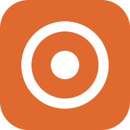
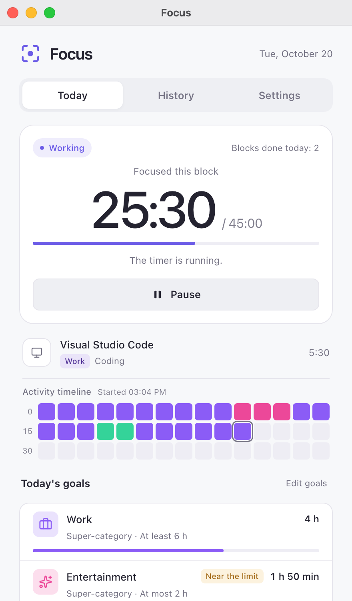
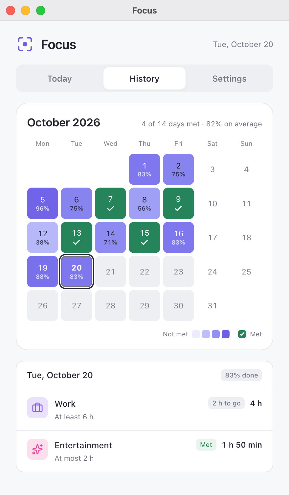
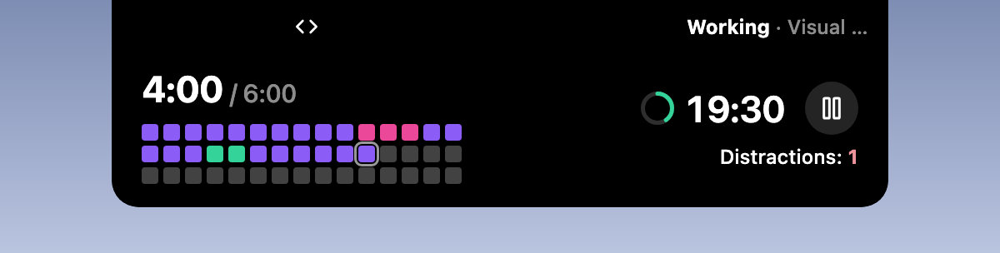

  

<h1 align="center">Focus</h1>

  <a href="intro/zh/README.md">简体中文</a> · <a href="intro/zh-TW/README.md">繁體中文</a> · <a href="README.md">English</a> · <a href="intro/ja/README.md">日本語</a> · <a href="intro/pt/README.md">Português</a> · <a href="intro/es/README.md">Español</a>

The official focus plugin for [Hindsight](https://github.com/Tomotsugu-dev/Hindsight). Based on your Hindsight categories, it times your work automatically, reminds you to take breaks, and keeps an eye on your daily goals.

  <table>
    <tr>
      <td align="center">
         
        <b>Today</b> · Time focused this block, activity timeline, and today's goals
      </td>
      <td align="center">
         
        <b>History</b> · A heatmap of how well each day this month met your goals
      </td>
    </tr>
  </table>

   
  <b>Island</b> · The category of the window you're focused on, and the focus countdown

   
  <b>Expanded</b> · The expanded island shows today's goal progress, the activity timeline, and your distractions, and lets you pause right there

## Features

- **Work rhythm**: The timer starts when you switch to a work category. After 45 minutes, it reminds you to take a 15-minute break.
- **Off-task alert**: After 5 minutes off task in a row, you get a reminder and the timer pauses.
- **Daily goals**: For example, at least 6 hours of Work and at most 2 hours of Entertainment. You get a reminder when you reach or exceed a goal.
- **Monthly calendar**: See at a glance whether you met your goals on each workday this month.
- **Island support**: When turned on, the timer shows on the island while the window is minimized or closed (macOS).

## Installation

Requires Hindsight 0.10.0 or later. In Hindsight, go to **Settings → Plugins**, find **Focus**, and install it.

## Icon licenses

The category icons on the page ([ui/icons.js](ui/icons.js)) and the check mark on the History page come from [Lucide](https://lucide.dev) (lucide-react 1.14.0), the same set as in Hindsight's main window.

- Lucide is under the ISC license.
- Some of its icons (such as Code and Check) come from [Feather](https://feathericons.com), under the MIT license.

The full text of both licenses is in [LICENSE-lucide.txt](LICENSE-lucide.txt), which is also included in the plugin package.
