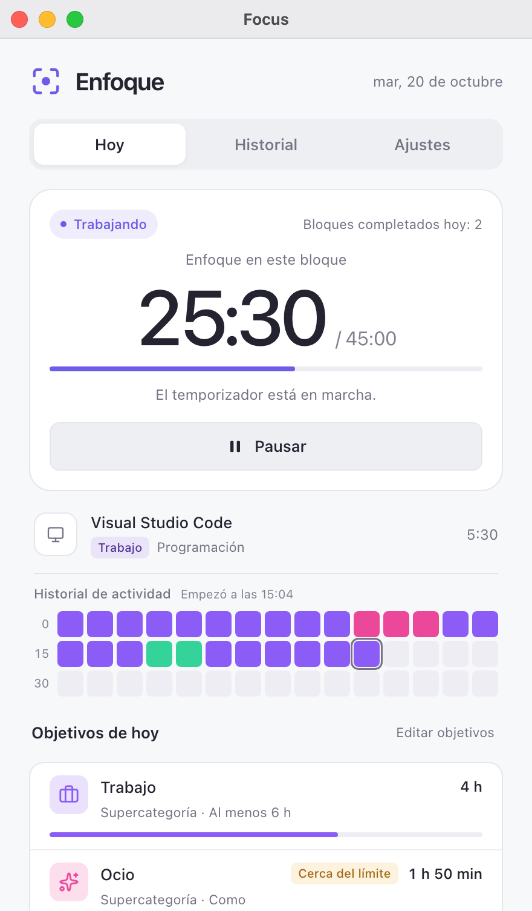
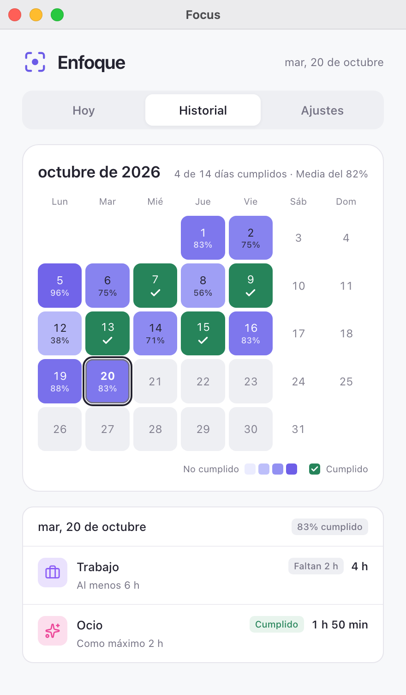
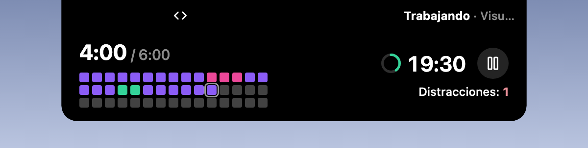

# Enfoque (Focus)

  <a href="../zh/README.md">简体中文</a> · <a href="../zh-TW/README.md">繁體中文</a> · <a href="../../README.md">English</a> · <a href="../ja/README.md">日本語</a> · <a href="../pt/README.md">Português</a> · <a href="README.md">Español</a>

El plugin de enfoque oficial de [Hindsight](https://github.com/Tomotsugu-dev/Hindsight). A partir de tus categorías de Hindsight, cronometra tu trabajo automáticamente, te recuerda descansar y vigila tus objetivos diarios.

  <table>
    <tr>
      <td align="center">
         
        <b>Hoy</b> · Tiempo de enfoque en este bloque, historial de actividad y objetivos de hoy
      </td>
      <td align="center">
         
        <b>Historial</b> · Mapa de calor de los objetivos cumplidos cada día del mes
      </td>
    </tr>
  </table>

   
  <b>Isla</b> · La categoría de la ventana activa y la cuenta atrás del enfoque

   
  <b>Expandida</b> · Al expandirse, la isla muestra el progreso de los objetivos de hoy, el historial de actividad y las distracciones, y permite pausar desde ahí

## Funciones

- **Ritmo de trabajo**: el temporizador empieza al cambiar a una categoría de trabajo. A los 45 minutos, te recuerda descansar 15 minutos.
- **Aviso de distracción**: tras 5 minutos seguidos de distracción, te avisa y pausa el temporizador.
- **Objetivos diarios**: por ejemplo, al menos 6 horas de Trabajo y como máximo 2 horas de Ocio. Te avisa al cumplir o superar un objetivo.
- **Calendario del mes**: comprueba de un vistazo si cumpliste tus objetivos cada día laborable del mes.
- **Compatible con la isla**: si lo activas, el temporizador aparece en la isla mientras la ventana está minimizada o cerrada (macOS).

## Instalación

Requiere Hindsight 0.10.0 o posterior. En Hindsight, ve a **Ajustes → Plugins**, busca **Focus** e instálalo.

## Licencia de los iconos

Los iconos de categoría de la página ([ui/icons.js](../../ui/icons.js)) y la marca de verificación de la página Historial provienen de [Lucide](https://lucide.dev) (lucide-react 1.14.0), el mismo conjunto que usa la ventana principal de Hindsight.

- Lucide usa la licencia ISC.
- Algunos de sus iconos (como Code y Check) provienen de [Feather](https://feathericons.com), con licencia MIT.

El texto completo de ambas licencias está en [LICENSE-lucide.txt](../../LICENSE-lucide.txt), que también se incluye en el paquete del plugin.
