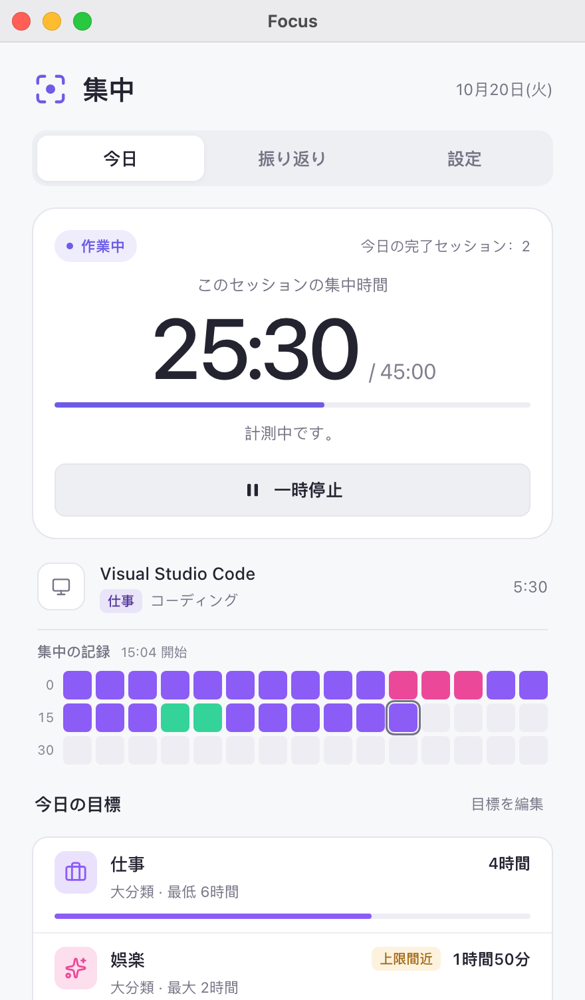
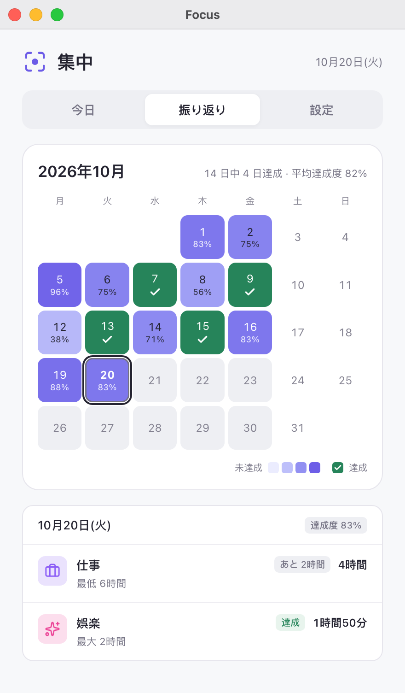
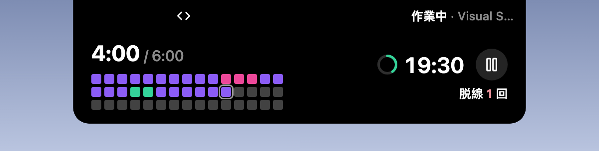

# 集中（Focus）

  <a href="../zh/README.md">简体中文</a> · <a href="../zh-TW/README.md">繁體中文</a> · <a href="../../README.md">English</a> · <a href="README.md">日本語</a> · <a href="../pt/README.md">Português</a> · <a href="../es/README.md">Español</a>

[Hindsight](https://github.com/Tomotsugu-dev/Hindsight) 公式の集中プラグインです。Hindsight の分類をもとに、作業時間を自動で計り、休憩を知らせ、毎日の目標を見守ります。

  <table>
    <tr>
      <td align="center">
         
        <b>今日</b> · このセッションの集中時間、集中の記録、今日の目標
      </td>
      <td align="center">
         
        <b>振り返り</b> · 今月の毎日の目標達成状況を示すヒートマップ
      </td>
    </tr>
  </table>

   
  <b>アイランド</b> · いま使っているウィンドウの分類と、集中のカウントダウン

   
  <b>展開</b> · 展開すると、今日の目標の進み具合、集中の記録、脱線の回数を表示し、その場で一時停止もできます

## 機能

- **作業リズム**：作業の分類に切り替えると計測が始まり、45 分たつと 15 分の休憩を知らせます。
- **脱線の通知**：5 分続けて脱線すると知らせ、計測を止めます。
- **毎日の目標**：たとえば仕事は最低 6 時間、娯楽は最大 2 時間。達成したときや超えたときに知らせます。
- **月間カレンダー**：今月の稼働日ごとに目標を達成したかが一目でわかります。
- **アイランド対応**：オンにすると、ウィンドウを最小化するか閉じたときに、タイマーをアイランドに表示します（macOS）。

## インストール

Hindsight 0.10.0 以降が必要です。Hindsight の「設定 → プラグイン」で「Focus」を探して、インストールしてください。

## アイコンのライセンス

ページの分類アイコン（[ui/icons.js](../../ui/icons.js)）と振り返りページのチェックマークは [Lucide](https://lucide.dev)（lucide-react 1.14.0）のもので、Hindsight のメイン画面と同じセットです。

- Lucide は ISC ライセンスです。
- その一部のアイコン（Code、Check など）は [Feather](https://feathericons.com) に由来し、MIT ライセンスです。

両方のライセンスの全文は [LICENSE-lucide.txt](../../LICENSE-lucide.txt) にあり、プラグインのパッケージにも同梱しています。
