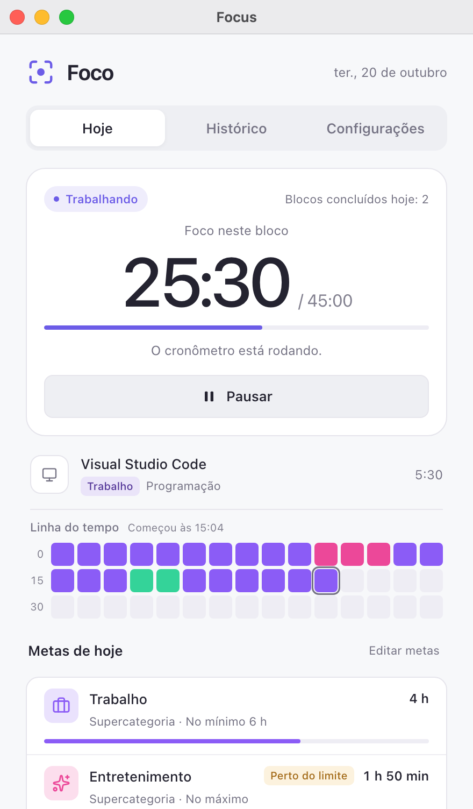
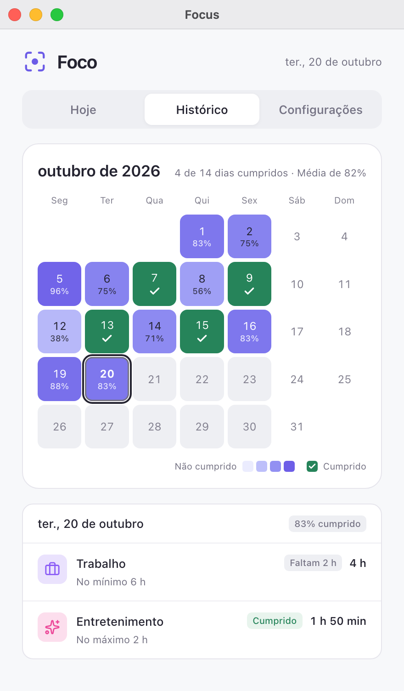
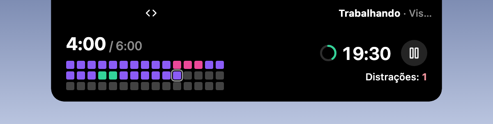

  

<h1 align="center">Foco (Focus)</h1>

  <a href="../zh/README.md">简体中文</a> · <a href="../zh-TW/README.md">繁體中文</a> · <a href="../../README.md">English</a> · <a href="../ja/README.md">日本語</a> · <a href="README.md">Português</a> · <a href="../es/README.md">Español</a>

O plugin de foco oficial do [Hindsight](https://github.com/Tomotsugu-dev/Hindsight). Com base nas suas categorias do Hindsight, ele cronometra o trabalho automaticamente, lembra você de fazer pausas e acompanha suas metas diárias.

  <table>
    <tr>
      <td align="center">
         
        <b>Hoje</b> · Tempo de foco neste bloco, linha do tempo e metas de hoje
      </td>
      <td align="center">
         
        <b>Histórico</b> · Mapa de calor das metas cumpridas em cada dia do mês
      </td>
    </tr>
  </table>

   
  <b>Ilha</b> · A categoria da janela em foco e a contagem regressiva do foco

   
  <b>Expandida</b> · Ao expandir, a ilha mostra o progresso das metas de hoje, a linha do tempo e as distrações, e dá para pausar ali mesmo

## Recursos

- **Ritmo de trabalho**: o cronômetro começa quando você muda para uma categoria de trabalho. Após 45 minutos, ele lembra você de descansar 15 minutos.
- **Alerta fora da tarefa**: depois de 5 minutos seguidos fora da tarefa, você recebe um aviso e o cronômetro pausa.
- **Metas diárias**: por exemplo, no mínimo 6 horas de Trabalho e no máximo 2 horas de Entretenimento. Você recebe um aviso ao cumprir ou ultrapassar uma meta.
- **Calendário do mês**: veja de relance se você cumpriu as metas em cada dia útil do mês.
- **Suporte à ilha**: quando ativado, o cronômetro aparece na ilha enquanto a janela está minimizada ou fechada (macOS).

## Instalação

Requer o Hindsight 0.10.0 ou mais recente. No Hindsight, abra **Ajustes → Plugins**, encontre **Focus** e instale.

## Licença dos ícones

Os ícones de categoria da página ([ui/icons.js](../../ui/icons.js)) e a marca de verificação da página Histórico vêm do [Lucide](https://lucide.dev) (lucide-react 1.14.0), o mesmo conjunto da janela principal do Hindsight.

- O Lucide usa a licença ISC.
- Alguns dos ícones (como Code e Check) vêm do [Feather](https://feathericons.com), sob a licença MIT.

O texto completo das duas licenças está em [LICENSE-lucide.txt](../../LICENSE-lucide.txt), que também acompanha o pacote do plugin.
