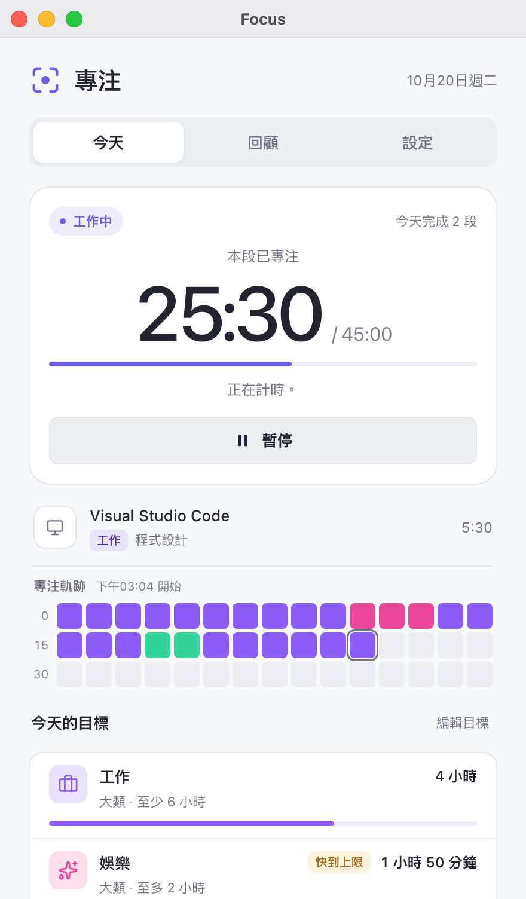
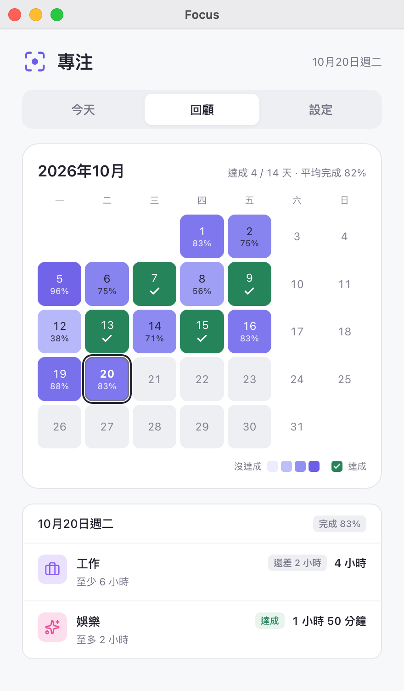
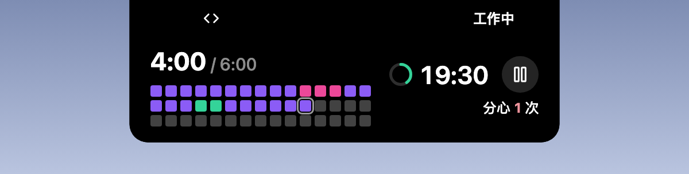

# 專注（Focus）

  <a href="../zh/README.md">简体中文</a> · <a href="README.md">繁體中文</a> · <a href="../../README.md">English</a> · <a href="../ja/README.md">日本語</a> · <a href="../pt/README.md">Português</a> · <a href="../es/README.md">Español</a>

[Hindsight](https://github.com/Tomotsugu-dev/Hindsight) 官方的專注外掛：依照你在 Hindsight 裡的分類，自動替工作計時、提醒休息、盯緊每天的目標。

  <table>
    <tr>
      <td align="center">
         
        <b>今天</b> · 本段已專注時間、專注軌跡、今天的目標
      </td>
      <td align="center">
         
        <b>回顧</b> · 本月每天的目標達成情況熱圖
      </td>
    </tr>
  </table>

   
  <b>靈動島</b> · 目前正在使用的視窗所屬的分類，以及專注倒數計時

   
  <b>展開</b> · 靈動島展開後顯示今天的目標進度、專注軌跡和分心次數，也能直接暫停

## 功能

- **工作節奏**：切到工作分類就開始計時，滿 45 分鐘提醒休息 15 分鐘。
- **摸魚提醒**：連續摸魚 5 分鐘就提醒，並暫停計時。
- **每日目標**：例如工作至少 6 小時、娛樂至多 2 小時，完成或超出時提醒。
- **月曆回顧**：本月每個工作日有沒有達成目標，一目了然。
- **靈動島支援**：開啟後，視窗最小化或關閉時，計時會顯示在靈動島上（macOS）。

## 安裝

需要 Hindsight 0.10.0 或更新版本。在 Hindsight 的「設定 → 外掛」裡找到「Focus」，安裝即可。

## 圖示授權

頁面上的分類圖示（[ui/icons.js](../../ui/icons.js)）和回顧頁的勾號，取自 [Lucide](https://lucide.dev)（lucide-react 1.14.0），和 Hindsight 主介面用的是同一套。

- Lucide 採用 ISC 授權。
- 其中一部分圖示（例如 Code、Check）來自 [Feather](https://feathericons.com)，採用 MIT 授權。

兩份授權的全文都在 [LICENSE-lucide.txt](../../LICENSE-lucide.txt)，外掛安裝檔裡也附有這個檔案。
