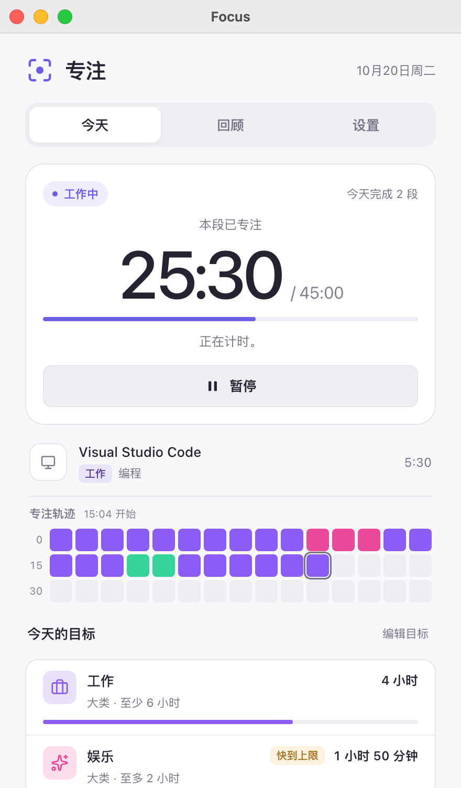
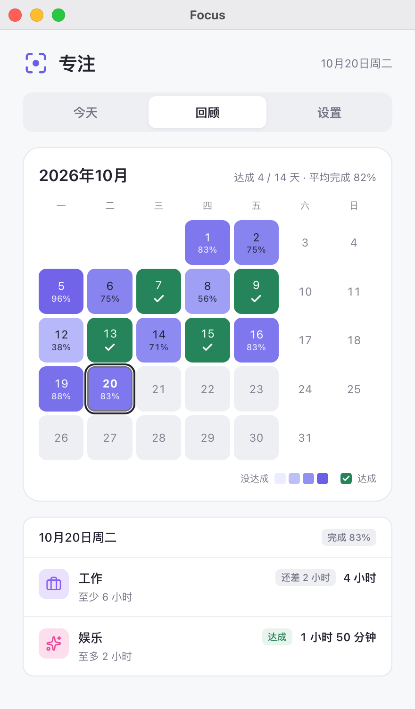

  

<h1 align="center">专注（Focus）</h1>

  <a href="README.md">简体中文</a> · <a href="../zh-TW/README.md">繁體中文</a> · <a href="../../README.md">English</a> · <a href="../ja/README.md">日本語</a> · <a href="../pt/README.md">Português</a> · <a href="../es/README.md">Español</a>

[Hindsight](https://github.com/Tomotsugu-dev/Hindsight) 官方的专注插件：按你在 Hindsight 里的分类，自动给工作计时、提醒休息、盯住每天的目标。

  <table>
    <tr>
      <td align="center">
         
        <b>今天</b> · 本段已专注时间、专注轨迹、今天的目标
      </td>
      <td align="center">
         
        <b>回顾</b> · 本月每天的目标达成情况热图
      </td>
    </tr>
  </table>

   
  <b>灵动岛</b> · 目前正在聚焦的窗口对应的分类和专注倒计时

   
  <b>展开</b> · 灵动岛展开后显示今天的目标进度、专注轨迹和分心次数，也能直接暂停

## 功能

- **工作节奏**：切到工作分类就开始计时，满 45 分钟提醒休息 15 分钟。
- **摸鱼提醒**：连续摸鱼 5 分钟就提醒，并暂停计时。
- **每日目标**：比如工作至少 6 小时、娱乐至多 2 小时，完成或超出时提醒。
- **月历回顾**：本月每个工作日有没有达成目标，一眼看清。
- **灵动岛支持**：开启后，窗口最小化或关掉时，计时显示在灵动岛上（macOS）。

## 安装

需要 Hindsight 0.10.0 或更新。在 Hindsight 的「设置 → 插件」里找到「Focus」，安装即可。

## 图标许可

页面上的分类图标（[ui/icons.js](../../ui/icons.js)）和回顾页的对勾，取自 [Lucide](https://lucide.dev)（lucide-react 1.14.0），和 Hindsight 主界面用的是同一套。

- Lucide 用 ISC 许可。
- 其中一部分图标（比如 Code、Check）来自 [Feather](https://feathericons.com)，用 MIT 许可。

两份许可的全文都在 [LICENSE-lucide.txt](../../LICENSE-lucide.txt)，插件安装包里也带着这个文件。
